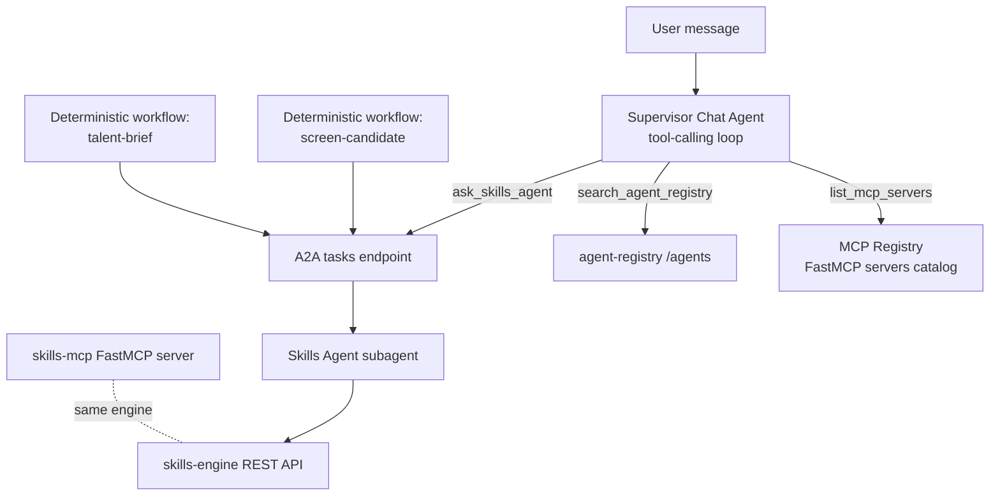

# Skills Supervisor

[](https://github.com/hari2353/skills-supervisor/actions/workflows/ci.yml)

The orchestration tier of the skills stack: a **supervisor chat agent with LLM tool-calling**, an
**A2A skills subagent**, **deterministic workflows**, and an **MCP server registry** — wired to
[skills-engine](https://github.com/hari2353/skills-engine), [skills-mcp](https://github.com/hari2353/skills-mcp),
and [agent-registry](https://github.com/hari2353/agent-registry).



## The three integration surfaces

| Surface | Protocol | Role |
|---|---|---|
| `SkillsAgent` | **A2A** — agent card + `/a2a/skills-agent/tasks` | subagent that *does* skill work; returns structured artifacts with task IDs |
| `SupervisorChatAgent` | **LLM function calling** (OpenAI-compatible) | plans and delegates via 3 tools; never fabricates — every fact is traced to the tool that produced it |
| `McpRegistry` | **FastMCP** catalog | registers/discovers MCP servers (defaults ship the `skills-engine-tools` FastMCP server), health probing |

## Supervisor tools

- `ask_skills_agent(skill, params)` — delegates to the A2A subagent (`infer_skills`, `normalize_skill`,
  `search_taxonomy`, `lifecycle_report`)
- `search_agent_registry(skill_name)` — discovers registered agents covering a skill
- `list_mcp_servers()` — inspects MCP infrastructure

The loop runs up to 6 rounds; tool failures become structured messages the LLM sees (graceful degradation,
never silent). Every response carries a `tool_trace`.

## Workflows (no LLM decisioning)

`POST /workflows/screen-candidate` `{jd_text, resume_text}` → required-vs-candidate skill sets, coverage ratio,
gaps, verdict (`strong_match` / `partial_match` / `no_overlap`). Deterministic, testable, auditable — the same
delegation path as chat but without model variance.

## Run

```bash
pip install -r requirements.txt
uvicorn skills_supervisor.app:app --reload --port 8010

export SKILLS_LLM_BASE_URL=http://localhost:11434/v1   # Ollama/Groq/vLLM — any OpenAI-compatible endpoint
curl -X POST localhost:8010/chat -d '{"message": "What does this JD need? ..."}' -H "Content-Type: application/json"
```

## Tests

36 tests cover: A2A task routing + outage containment, tool-manifest schema validity, delegation loop with
scripted fake LLMs, error-tracing in dispatch, deterministic workflows, MCP registry persistence + health.

### Conversation + trace + workflow hardening (market-steal, 2026-11-18)

- **Bounded conversation memory** — `SupervisorChatAgent(max_messages=24)`
  keeps the system prompt pinned and the newest N messages, dropping a
  leading `tool` message whose parent assistant `tool_calls` fell off the
  window (no orphans for strict chat APIs).
- **Trace enrichment** — every `tool_trace` entry now carries `duration_ms`,
  plus the `error` text when the call failed; existing keys unchanged.
- **Workflow input validation** — empty/oversized (8000 chars) jd/resume/topic
  fail before any A2A call; a JD that yields zero skills returns a clear
  `failed` error instead of a meaningless coverage verdict.
- **Agent repair contract** — expected failures keep their `error` string and
  add `diagnostic` (`{code, message, hint, docs}`); HTTP 422 puts it in
  `detail`. Catalog: `docs/diagnostics.md`.

MIT
